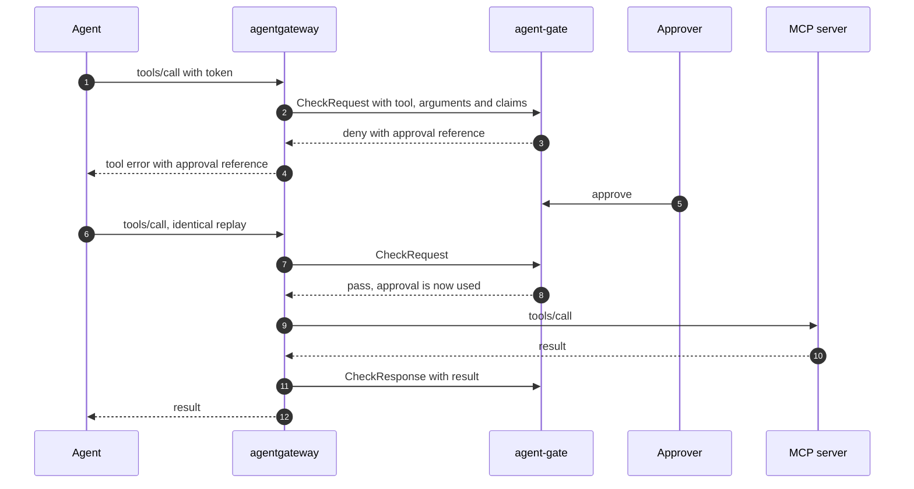

<div align="center">

# agent-gate

**Put a human in the path of risky AI agent actions.**

Policy, approval and verifiable audit for MCP tool calls, as an [agentgateway](https://github.com/agentgateway/agentgateway) extension.

[](https://github.com/vanlabs-dev/agent-gate/actions/workflows/extmcp.yml)
[](LICENSE)
[](docs/roadmap.md)

[](test/extmcp/go.mod)
[](test/extmcp/versions.env)
[](https://github.com/modelcontextprotocol/go-sdk)
[](https://github.com/agentgateway/agentgateway/blob/v1.7.0/crates/protos/proto/ext_mcp.proto)
[](test/extmcp/deploy)
[](test/extmcp/versions.env)
[](test/extmcp/Dockerfile)
[](.github/workflows/extmcp.yml)

[Vision](docs/vision.md) · [Architecture](docs/architecture/options.md) · [Decisions](docs/adr/) · [Roadmap](docs/roadmap.md)

</div>

## Why

Organisations want agents that act on real systems. Three questions stop them:

- What may this agent do?
- Who approved the risky action?
- Can we prove it afterwards?

Gateways route, authenticate and rate-limit agent traffic. agent-gate adds the human decision and the record that a third party can check.

| It does | How |
|---|---|
| Decides each MCP tool call | Policy returns allow, deny or needs approval |
| Holds risky calls for a human | The approver decides in an inbox, and cannot be the requester |
| Passes an approved call once | The approval is bound to the caller, the tool and the exact arguments |
| Proves what happened | A hash-chained audit log with signed checkpoints outside the cluster |

## Status

> [!NOTE]
> Phase 1 of the [roadmap](docs/roadmap.md) is next. Phase 0 is complete. The integration with agentgateway is proven by a compatibility test, with a stub in place of the gate. The gate does not exist yet.

## How it works

agent-gate is not a gateway. agentgateway carries the traffic and asks the gate for a decision on each `tools/call`. The gate cannot hold a connection open for hours, so it denies with an approval reference, and the agent replays the identical call after a human approves it.



[ADR 0002](docs/adr/0002-integrate-through-agentgateway-extmcp.md) records why the gate is an extension. [ADR 0009](docs/adr/0009-suspension-deny-and-replay.md) records the deny and replay contract.

## What is proven today

The compatibility test runs 12 scenarios against real agentgateway v1.7.0 on `kind`. A stub gate and a stub MCP server take the place of the real services.

| Contract | Scenario |
|---|---|
| An ungated call reaches the upstream server | Ungated tool |
| A gated call is denied with an approval reference, and the upstream server receives nothing | First call to a gated tool |
| An approved call passes once, in a new session with a new token | Replay after approval |
| A used approval does not pass again | Second replay of a used approval |
| An approval is bound to the arguments | Replay with changed arguments |
| An approval is bound to the caller | Replay by a different caller |
| The gate receives the tool, the arguments and a validated identity claim, and never the token | Call with a valid token |
| The gateway rejects a bad token before the gate and the upstream server | Call with a token that fails validation, Call with no token |
| The gate receives the result of a passed call | Result of a passed call |
| A gate slower than the 5 s callout deadline fails closed within the deadline | Gate slower than the deadline |
| A gate outage fails closed | Gate unavailable |

The full contract is in the [spec](openspec/specs/agentgateway-integration/spec.md).

The gate end-to-end test, `make e2e-gate`, runs 14 scenarios against the real gate on its own `kind` cluster, with Dex as the OIDC issuer and Postgres as the store. It covers allow, deny, approval with one identical replay, the requester rule, expiry, rejection, a call with no identity, and an audit export that `agent-gate-audit verify` accepts and rejects after one entry is changed, removed or swapped. The specs are [tool-call-policy](openspec/specs/tool-call-policy/spec.md), [tool-call-approval](openspec/specs/tool-call-approval/spec.md) and [audit-log](openspec/specs/audit-log/spec.md).

## Run the checks

Required tools: Go, `uv` and `make`. The check tools run through `go run`, pinned in [`versions.env`](versions.env).

```sh
make check    # lint and unit tests, no cluster
make vuln     # govulncheck
make secrets  # gitleaks on the history of HEAD
```

[`AGENTS.md`](AGENTS.md) lists each command and what it needs.

## Run the compatibility test

Required tools: Go, Docker, `kind`, `kubectl`, Helm 4 and `make`. Versions are pinned in [`test/extmcp/versions.env`](test/extmcp/versions.env).

```sh
make e2e
```

The command creates the `kind` cluster `agent-gate-extmcp`, deploys the pinned agentgateway with both stubs, and runs each scenario. It exits 0 only when every scenario passes. It takes about one minute, and keeps its kubeconfig in `test/extmcp/.kube/`.

```text
--- PASS: TestE2E (1.68s)
    --- PASS: TestE2E/Ungated_tool (0.01s)
    --- PASS: TestE2E/First_call_to_a_gated_tool (0.00s)
    --- PASS: TestE2E/Replay_after_approval (0.01s)
    --- PASS: TestE2E/Second_replay_of_a_used_approval (0.01s)
    --- PASS: TestE2E/Replay_with_changed_arguments (0.01s)
    --- PASS: TestE2E/Replay_by_a_different_caller (0.01s)
    --- PASS: TestE2E/Call_with_a_valid_token (0.00s)
    --- PASS: TestE2E/Call_with_a_token_that_fails_validation (0.00s)
    --- PASS: TestE2E/Call_with_no_token (0.00s)
    --- PASS: TestE2E/Result_of_a_passed_call (0.00s)
    --- PASS: TestE2E/Gate_unavailable (1.62s)
```

```sh
make clean
```

This deletes the clusters of `make e2e` and `make e2e-gate`.

## Run the gate end-to-end test

Required tools: the same as the compatibility test. The Dex and Postgres images are pinned in [`gate/versions.env`](gate/versions.env).

```sh
make e2e-gate
```

The command creates the `kind` cluster `agent-gate-e2e`, deploys agentgateway, Dex, Postgres, the gate and the stub MCP server, runs the Postgres store tests and each scenario, and exits 0 only when all pass. The expiry scenario waits 31 s. The kubeconfig is in `gate/.kube/`.

## Where it fits

| Concern | Owner |
|---|---|
| MCP and LLM traffic, routing, token budgets | [agentgateway](https://github.com/agentgateway/agentgateway) |
| Agent and human identity | Microsoft Entra ID and Entra Agent ID |
| Policy decision, approval, audit | agent-gate |

A team that does not run agentgateway or Entra should look at [Preloop](https://github.com/preloop/preloop) first. The [vision](docs/vision.md) compares agent-gate with the prior art.

## Roadmap

| Phase | Ships | State |
|---|---|---|
| 0 Foundations | Repo, conventions, CI, and the agentgateway spike | Done |
| 1 Core on `kind` | Policy engine, approvals, replay, hash-chained audit, verifier CLI, minimal inbox | In progress: all but the inbox are built |
| 2 Azure | Terraform, AKS, keyless deploy, Entra token checks | Planned |
| 3 Agent and demo | Python ops agent with one real action, guest sign-in, guided tour | Planned |

The [roadmap](docs/roadmap.md) holds every phase and its exit test.

## Repo layout

| Path | Content |
|---|---|
| [`gate/`](gate/) | The gate: policy, approvals, audit, the `ExtMcp` adapter, the Postgres store, the `agent-gate-audit` CLI and its end-to-end test |
| [`test/extmcp/`](test/extmcp/) | The compatibility test: stub gate, stub MCP server, `kind` manifests, pinned versions |
| [`agents/azure-ops/`](agents/azure-ops/) | The Python project of the ops agent. Scaffold only until Phase 3 |
| [`docs/`](docs/) | Vision, architecture, decision records, roadmap, cost model, conventions |
| [`openspec/`](openspec/) | The proposal, design, specs and tasks of each change |

## Licence

[Apache-2.0](LICENSE)
