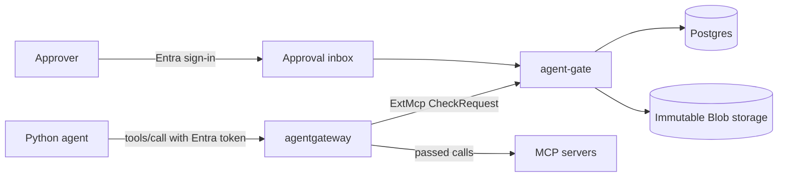
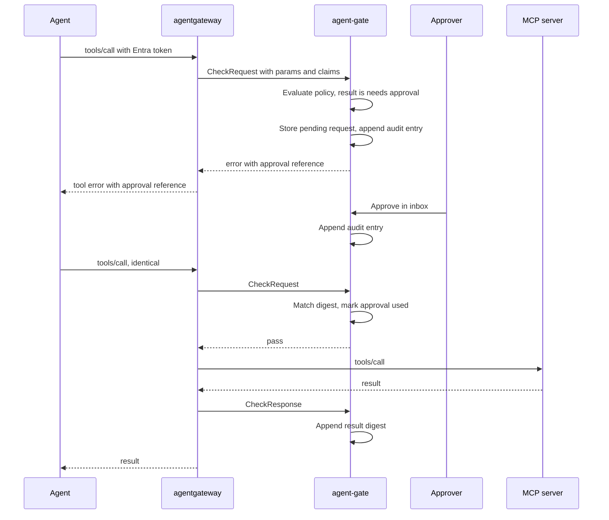
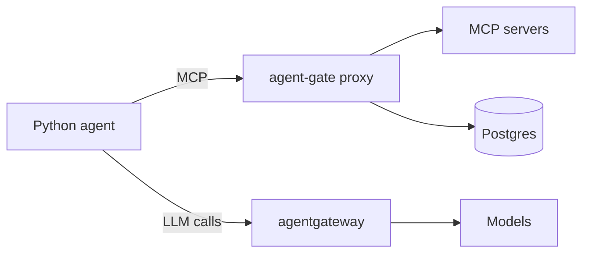
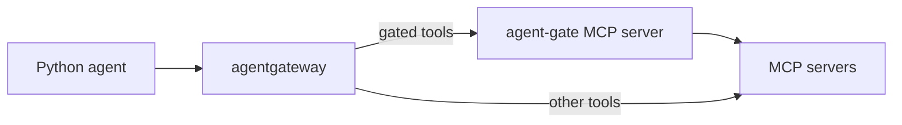

# Architecture options

Three shapes were considered. Option A is the chosen direction. The Phase 0 spike confirmed it on 2026-11-16 against agentgateway v1.7.0 ([ADR 0002](../adr/0002-integrate-through-agentgateway-extmcp.md)). Facts about other projects were checked on 2026-11-16. Facts about agentgateway behaviour come from its [v1.7.0 source](https://github.com/agentgateway/agentgateway/tree/v1.7.0/crates/agentgateway/src/mcp), read on that date.

## Summary

| | A: gate as extension (chosen) | B: gate as proxy | C: gate as MCP target |
|---|---|---|---|
| Shape | Go service that agentgateway calls through `ExtMcp` | Standalone MCP reverse proxy in Go | Go MCP server that agentgateway routes gated tools to |
| Code this project owns | Policy, approval, audit, inbox | The same, plus MCP proxying | The same, plus upstream execution |
| Can suspend a call | No: deny, then replay | Yes, through MCP tasks, which no client supports yet | Yes, with the same limit |
| Main risk | Early extension API on a project with monthly releases | Rebuilds a gateway alone against a moving spec | Two hops and duplicated routing |

## Option A: gate as extension

agentgateway carries MCP and LLM traffic. For each MCP call it asks agent-gate for a decision through its `ExtMcp` gRPC extension.

### Components

- **agentgateway:** validates the Entra token, routes MCP and LLM traffic, enforces token budgets.
- **agent-gate:** `ExtMcp` server, policy engine, approval API and inbox, audit appender, checkpoint signer.
- **Postgres:** approval requests, audit entries, checkpoints.
- **Verifier CLI:** checks the audit chain against the signed checkpoints.
- **Python agent:** the reference agent. See [ADR 0004](../adr/0004-anchor-agent-azure-ops.md).

### What the extension point allows

The `ExtMcp` service has two calls, `CheckRequest` and `CheckResponse` ([proto](https://github.com/agentgateway/agentgateway/blob/main/crates/protos/proto/ext_mcp.proto)). Each can return one of three results:

- `pass`
- `mutated`: replace the params or the result
- `error`: deny

No result answers the client without a call to the upstream server. [Issue #3003](https://github.com/agentgateway/agentgateway/issues/3003) requests one and is open. The gate therefore cannot return a pending result. It denies, and the agent replays the call after approval.

`ExtMcp` names the gRPC service only. The feature is configured as `backend.mcp.guardrails` in an `AgentgatewayPolicy`: a `remote` processor names the gate service, and each MCP method gets a phase, `Request`, `Response` or `Full`.

A deny of a `tools/call` reaches the client as a tool result with `isError` true. Its one text block holds the gate's `reason`. The structured `mcp_error` payload is dropped on this path, so the approval reference travels as text. With the code `UNKNOWN` the client receives a JSON-RPC internal error, the same shape as a gate outage.

### Request flow for a call that needs approval

1. The agent gets an Entra token and calls `tools/call` through agentgateway.
2. agentgateway validates the token and sends the call and identity claims to the gate.
3. The gate evaluates policy. The result is allow, deny or needs approval.
4. For needs approval, the gate stores a pending request. The key is a digest of tenant, agent, target, tool and canonical arguments. The gate appends an audit entry and shows the request in the inbox.
5. The gate denies with an approval reference.
6. The agent stores the exact call and waits.
7. A human signs in to the inbox and decides. The gate rejects an approver who is the requester. It appends an audit entry.
8. The agent replays the call. The gate matches the digest, marks the approval used, and passes the call.
9. The gate records a digest of the result.

### Known limits of A

- The agent must replay the stored call. If it asks the model again and the arguments change, the digest does not match.
- The gate sees claims only when a `jwtAuthentication` policy is attached to the route ([issue #3485](https://github.com/agentgateway/agentgateway/issues/3485)).
- Each claim reaches the gate through a `metadata` expression such as `jwt.sub`. A failed expression is skipped with a debug log. The gate must therefore deny a call that carries no identity claim, or an approval binds to no caller.
- The gate receives the gateway's re-encoding of the params with `_meta` merged in, not the client's bytes. The approval digest must read only the tool name and the arguments.
- An empty `allowedRequestHeaders` forwards every request header to the gate. Set the list. The gateway removes the token after validation unless `preserveToken` is set.
- `CheckResponse` does not run for upstream errors ([issue #4245](https://github.com/agentgateway/agentgateway/issues/4245)), so a failed execution leaves no result digest.
- The callout deadline is the `requestTimeout` of a backend policy on the gate service. With 5 s set and a gate that delays its answer by 10 s, the client got a JSON-RPC error (`-32603`, "guardrail check failed") after 5.00 s, and the upstream got no call (measured 2026-11-25, scenario "Gate slower than the deadline" of `make e2e`). The gate bounds its own work to 3 s, below that deadline.
- A gate outage fails closed when `failureMode` is `FailClosed`, the default. The client receives a JSON-RPC internal error and the upstream server receives no call. The compatibility test proves this.
- `ExtMcp` is a young API. The agentgateway version is pinned, and an upgrade must pass the compatibility test in `test/extmcp/`.

## Option B: gate as proxy

agent-gate is its own MCP reverse proxy. An adopted component still carries LLM traffic.

### Request flow for a call that needs approval

1. The agent calls `tools/call` on the gate with an Entra token.
2. The gate validates the token and evaluates policy.
3. The gate stores a pending request and appends an audit entry.
4. If the client declared the MCP tasks extension, the gate returns a task handle. If not, it denies with an approval reference, as in option A.
5. A human decides in the inbox.
6. With tasks, the gate calls the upstream server itself and serves the result through `tasks/get`. Without tasks, the agent replays the call.

B gives true suspension, but only through the [MCP tasks extension](https://modelcontextprotocol.io/extensions/tasks/overview). On 2026-11-16 the [client matrix](https://modelcontextprotocol.io/extensions/client-matrix) listed no client that supports it. B also means that this project maintains an MCP proxy against a moving spec.

## Option C: gate as MCP target

agentgateway routes gated tools to agent-gate, which is an MCP server that calls the real upstream after approval.

C keeps agentgateway in front and lets the gate execute after approval. It adds a second hop and duplicates routing configuration in two places.

## Cross-cutting design

### Audit

- Each entry holds the hash of the entry before it. Its own hash is SHA-256 over a domain string and the RFC 8785 encoding of the entry. The entry holds digests of arguments and results, not the values.
- One appender writes under a Postgres advisory lock, so the chain has one order.
- Every N entries the gate writes a checkpoint of the chain head. In Phase 1 checkpoints are unsigned. From Phase 4, the gate signs each checkpoint with a Key Vault key and writes it to immutable Blob storage.
- `agent-gate-audit verify` recomputes the chain of an export and compares it with the checkpoints. The formats are in the [audit-log spec](../../openspec/specs/audit-log/spec.md).

### Identity

- AKS workload identity gives the agent pod a managed identity. That identity is the credential for an Entra Agent ID blueprint.
- Policy can use these [token claims](https://learn.microsoft.com/en-us/entra/agent-id/agent-token-claims): `tid`, `azp`, `oid`, `idtyp`, `roles`, and the agent markers `xms_act_fct` and `xms_sub_fct`.
- The approver signs in to the inbox with Entra OIDC.
- The gate reads the caller from one configured metadata key (default `sub`, `oid` from Phase 2) and the tenant from another (`tid` from Phase 2), or uses a fixed tenant. The route must forward each key, for example `oid: jwt.oid`.
- On `kind`, Dex v2.46.1 takes the place of Entra. Agents get tokens with the `client_credentials` grant, with the shared audience `agent-gate`. agentgateway reads the Dex JWKS through a remote `jwks` with a `backendRef` to the Dex service.

### Policy

The gate embeds OPA. It evaluates `data.agentgate.decision` over the Rego files of one directory, with input `{tenant, agent, target, tool, arguments, claims}`, and expects `{"outcome": "allow" | "deny" | "approve", "reason": string}`. Anything else is a deny. The [tool-call-policy spec](../../openspec/specs/tool-call-policy/spec.md) holds the contract.

### Transport independence

The policy, approval and audit code must not depend on `ExtMcp` types. The extension server is an adapter. A tasks front or a proxy front can then be added without a rewrite.

## Open decisions

| Decision | Options | Lean |
|---|---|---|
| State store | Postgres in the cluster on a disk, Azure Flexible Server B1ms | In-cluster first: US$3 against US$19 a month |
| LLM routing and budgets | agentgateway, LiteLLM | agentgateway: one data plane, fewer pods |
| Observability | OTel Collector to Application Insights, self-hosted Langfuse | Application Insights: no cluster memory, 5 GB free |
| Deploy | Helm from GitHub Actions, Flux | Helm first |

Each of these becomes an ADR when it is decided. The policy engine is OPA ([ADR 0010](../adr/0010-policy-engine-opa.md)).
